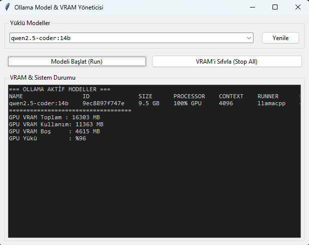
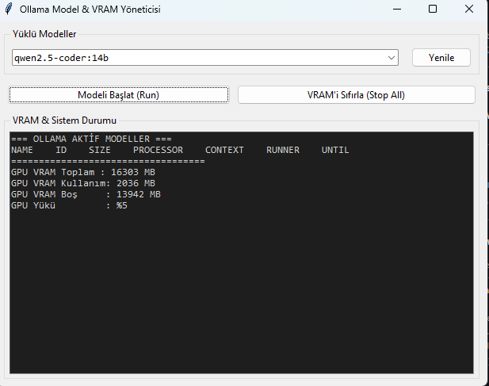

# Ollama Model & VRAM Manager

Windows üzerinde yerel Ollama modellerini yönetmek, VRAM ve GPU kullanımını canlı izlemek ve tek tıkla belleği temizlemek için geliştirilmiş hafif Tkinter arayüzü.





## Özellikler
- Kurulu Ollama modellerini listeleme ve seçili modeli çalıştırma.
- `nvidia-smi` üzerinden canlı VRAM ve GPU yük takibi.
- Bellekte asılı kalan modelleri sonlandırma (VRAM sıfırlama).

## Gereksinimler
- Python 3.10+
- Ollama
- NVIDIA GPU (nvidia-smi takibi için)

## Çalıştırma
```powershell
python ollama_panel.py